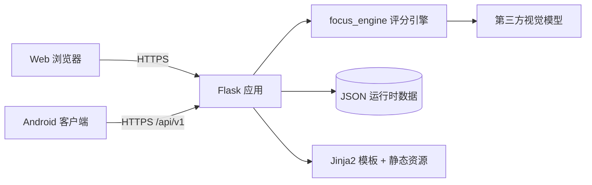

# FocalCove · 专注小窝

FocalCove（专注小窝）是一个开源的专注辅助原型：浏览器或 Android 客户端按固定节奏采集
屏幕画面，Flask 服务端调用视觉模型，把画面与用户写下的文字目标进行对比，输出四态结果
（专注、不确定、分心、待复核）、提醒和专注报告。

项目由学生团队开发，代表团队自身的工程与产品探索，不代表任何学校或机构的官方立场。
它提供辅助反馈，不构成医学、心理学或教育评价。

> **隐私与数据流警告**
>
> 启用屏幕采集后，当前屏幕的截图会通过 HTTPS 发送到你部署的 Flask 服务端，再由服务端
> 发送给配置的第三方视觉模型（SiliconFlow 或阿里云百炼）。不要在专注期间展示密码、
> 支付信息、证件、私聊或其他敏感内容。评测采样默认关闭；开启后会把原始截图与目标文本
> 写入磁盘，需要用户明确同意并自行管理保留期限。详见 [SECURITY.md](SECURITY.md)。

## 功能

- **Web 端**：注册登录、目标与时长设置、实时四态反馈、提醒、历史与趋势、小窝装扮、
  预览型奖励商店。
- **Android 端（Android 10 / API 29+）**：原生 Compose 界面、系统整屏共享授权、
  前台采集通知、三档提醒、报告与历史、小窝与兑换、近黑画面健康检测。
- **共享评分引擎**：四态评分、时序平滑、置信度收缩、有效覆盖率与可靠性标记、时长推荐。
- **评测工具**：样本采集、人工标注、复核、基准与调参脚本。仓库不附带任何真实样本。

## 架构



```text
app/                 Flask 应用工厂、蓝图、服务、中间件
focus_engine/        评分、时序、时长推荐、VLM 客户端、历史存储
templates/           Jinja2 页面
static/              CSS / JavaScript / 图片 / 本地 ECharts
scripts/             部署、备份、冒烟与评测辅助脚本
tests/               Python 测试
android/             Kotlin + Jetpack Compose 客户端
docs/                部署、发布清单与评分模型文档
deploy/example/      Docker Compose、Nginx 与环境变量示例
evaluation/          评测流程说明（不附带样本）
```

## 快速开始（Web）

需要 Python 3.12 或 3.13。

```bash
python -m venv .venv
# Windows: .venv\Scripts\activate
# POSIX:   source .venv/bin/activate
pip install -r requirements.txt
cp .env.example .env
```

编辑 `.env`，至少填写一个视觉提供方的 Key：

```dotenv
FOCUS_VISION_PROVIDER=bailian
BAILIAN_API_KEY=your_bailian_api_key
```

然后启动：

```bash
python app.py
```

打开 <http://127.0.0.1:5151/>。Windows 本地开发直接使用 `python app.py`；Gunicorn 面向
POSIX 与容器部署。

## 配置

| 变量 | 默认值 | 说明 |
| --- | --- | --- |
| `FOCUS_VISION_PROVIDER` | `bailian` | `bailian` 或 `siliconflow` |
| `BAILIAN_API_KEY` / `SILICONFLOW_API_KEY` | 空 | 仅放在服务端 `.env`，绝不进入客户端或前端 |
| `FOCUS_FRAME_INTERVAL_SECONDS` | `20` | 采集间隔 |
| `FOCUS_FRAME_DEADLINE_SECONDS` | `17` | 单帧处理截止时间 |
| `FOCUS_MODEL_TIMEOUT_SECONDS` | `16` | 视觉模型请求超时 |
| `FOCUS_MAX_IMAGE_EDGE` | `1024` | 送入模型前的最长边 |
| `FOCUS_EVAL_CAPTURE_ENABLED` | `false` | 是否保存评测样本；默认关闭 |
| `FOCUS_EVAL_CAPTURE_DIR` | `evaluation/inbox` | 样本目录；不要提交到 Git |
| `FOCUS_SCORING_POLICY_PATH` | 空 | 可选的评分策略覆盖文件 |
| `FOCUS_APP_SECRET` | 开发占位值 | 生产必须为至少 32 位随机值 |
| `BROWSER_AUTH_RATE_LIMIT` / `..._WINDOW_SECONDS` | `10` / `900` | 浏览器登录与注册限流 |
| `MOBILE_AUTH_RATE_LIMIT` / `..._WINDOW_SECONDS` | `20` / `60` | 移动认证限流 |
| `MOBILE_FRAME_RATE_LIMIT` / `..._WINDOW_SECONDS` | `6` / `60` | 移动截图上传限流 |

完整示例见 [.env.example](.env.example) 与
[deploy/example/.env.production.example](deploy/example/.env.production.example)。

## 评分与时长推荐

评分引擎把画面证据拆成多个维度，结合目标档案、时序平滑和置信度收缩，输出四种状态；
低覆盖或证据不足的记录会标记为“仅供参考”，不进入可靠均分。时长建议基于用户历史中
可靠的完成记录，冷启动时使用保守默认值。

- 完整模型说明：[docs/scoring-duration-model.md](docs/scoring-duration-model.md)
- 通俗说明：[docs/scoring-duration-model-plain-zh.txt](docs/scoring-duration-model-plain-zh.txt)

评分是“画面与文字目标的相关证据”，不是对注意力、能力或任务质量的测量。请以实际
任务进展为准。

## Android 构建

需要 JDK 17、Android SDK Platform/Build Tools 36 和 Gradle 8.11.1。

```bash
cd android
./gradlew -PFOCUS_API_BASE_URL=https://your-domain.example/ testDebugUnitTest assembleDebug
```

未提供地址时使用 `https://example.invalid/`，该地址故意不可连接。构建会拒绝 HTTP、
缺少主机名、包含账号密码、查询参数或片段的地址。详细说明见
[android/README.md](android/README.md)。

## 评测

`evaluation/` 只提供流程说明，不附带任何样本。采集、人工标注与基准脚本位于
`scripts/`，需要自备样本并遵守当地隐私法规。

```bash
python scripts/build_vision_manifest.py --help
python scripts/evaluate_vision_results.py --help
python scripts/benchmark_vision_models.py --help
python scripts/tune_scoring_policy.py --help
```

详见 [evaluation/README.md](evaluation/README.md)。运行评测会调用外部视觉模型并产生
费用。

## 部署

示例配置位于 `deploy/example/`：

- [deploy/example/README.md](deploy/example/README.md)：Docker、TLS、反向代理与运行卷
- [docs/deployment.md](docs/deployment.md)：单 worker、代理头、备份与回滚

原型只支持单个 Gunicorn worker；活动会话保存在进程内存，重启后不会恢复。不要把
开发机的 `users.json`、`user_data/`、`user_history/` 或 `.env` 打入镜像。

## 测试

```bash
pip install -r requirements-dev.txt
python -m pytest -q
```

Android：

```bash
cd android
./gradlew testDebugUnitTest lintDebug
```

GitHub Actions 会在 Python 3.12/3.13、Android 和 Docker 三个任务中执行对应检查。

## 原型限制与安全边界

- 无 CSRF 框架；依赖 `SameSite=Lax`、`Secure` Cookie 和同源部署。公开部署前建议补充
  CSRF 防护。
- 限流是进程内实现，只适用于单 worker；多实例需要共享存储。
- 无证书固定、无 Android instrumentation 测试、无多租户加固。
- 会话与运行数据使用 JSON 文件，适合原型，不适合高并发生产负载。
- 评测采集开启后会写入原始目标与截图，默认关闭，且没有自动过期策略。
- 外部视觉模型会接收屏幕帧与目标文本；使用者需自行确认提供方条款与数据合规要求。
- **本项目不适合直接暴露在公网。** 若要对外提供服务，请先完成安全评审、CSRF 防护、
  共享限流、备份与监控。

## 许可与声明

- 代码与团队自有视觉资产：[Apache License 2.0](LICENSE)
- 版权、商标与资产声明：[NOTICE](NOTICE)
- 第三方组件：[THIRD_PARTY_NOTICES.md](THIRD_PARTY_NOTICES.md)
- 贡献指南：[CONTRIBUTING.md](CONTRIBUTING.md)
- 安全策略：[SECURITY.md](SECURITY.md)
- 变更记录：[CHANGELOG.md](CHANGELOG.md)

Apache-2.0 不授予商标权；修改版本或二次分发不得暗示获得 FocalCove 团队的官方背书。
